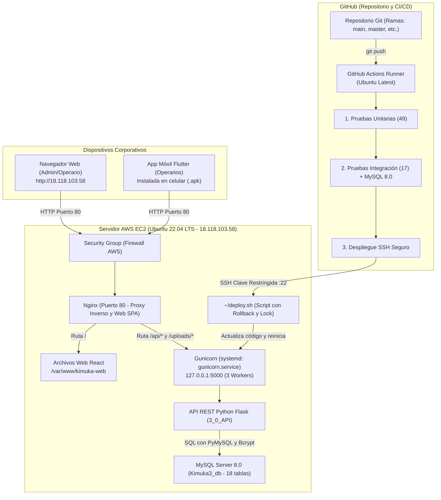
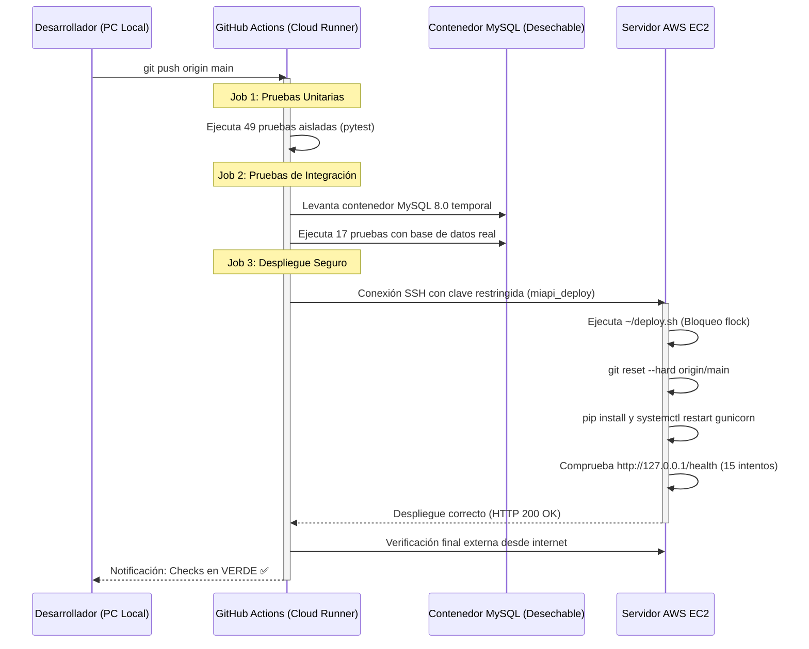

# Guía Maestra Definitiva de Despliegue y Sustentación — Kimuka ERP
**Proyecto:** Kimuka / Titan Sports  
**Entorno Cloud:** AWS EC2 (Ubuntu 22.04 LTS) — IP Pública: `18.118.103.58`  
**Arquitectura:** Intranet Corporativa Privada (Backend Flask + MySQL + Frontend React + Móvil Flutter)  
**Automatización:** Pipeline CI/CD con GitHub Actions y Rollback Automático

---

## 📌 1. Visión General de la Arquitectura

Kimuka es un sistema ERP de gestión operativa interna para fábricas de confección. No es un portal público ni una tienda electrónica: está restringido exclusivamente a administradores de planta y operarios.



---

## 🚀 PARTE 1: Despliegue Inicial del Backend y Base de Datos (AWS EC2)

### 1.1 Configurar el Servidor y la Base de Datos
En la máquina virtual EC2 (`18.118.103.58`):
```bash
# 1. Actualizar repositorios e instalar paquetes base
sudo apt update && sudo apt upgrade -y
sudo apt install -y python3 python3-pip python3-venv git nginx mysql-server pkg-config libmysqlclient-dev

# 2. Configurar la base de datos MySQL
sudo mysql
```
Dentro de la consola de MySQL:
```sql
CREATE DATABASE Kimuka3_db DEFAULT CHARACTER SET utf8mb4 COLLATE utf8mb4_spanish_ci;
CREATE USER 'kimuka_user'@'localhost' IDENTIFIED BY 'KimukaPass2026!';
GRANT ALL PRIVILEGES ON Kimuka3_db.* TO 'kimuka_user'@'localhost';
FLUSH PRIVILEGES;
EXIT;
```

### 1.2 Clonar el Proyecto y Preparar la API Flask
```bash
mkdir -p ~/miapi
cd ~/miapi
git clone https://github.com/Sofia20071019/codificacion---react.git .
cd 3_0_API

# Crear entorno virtual de Python e instalar librerías
python3 -m venv venv
source venv/bin/activate
pip install --upgrade pip
pip install -r requirements.txt
```

### 1.3 Archivo de Variables de Entorno (`.env`)
Crear el archivo `~/miapi/3_0_API/.env`:
```ini
MYSQL_USER=kimuka_user
MYSQL_PASSWORD=KimukaPass2026!
MYSQL_HOST=127.0.0.1
MYSQL_PORT=3306
MYSQL_DATABASE=Kimuka3_db
SECRET_KEY=94d7bfa5e7d43f295bc10ae4b2931a7f0516ec6f29cb91a27e31b67f1b790e6a
FLASK_DEBUG=false
```

### 1.4 Poblar las Tablas y Usuarios Iniciales
```bash
python3 sead.py
```
> **Usuarios listos en el sistema:**
> - **Administrador:** `admin@titan.com` | Contraseña: `admin123` (Rol: ROL-001)
> - **Operario / Empleado:** `empleado@titan.com` | Contraseña: `1234` (Rol: ROL-002)

### 1.5 Servicio de Producción con Gunicorn (`systemd`)
Archivo `/etc/systemd/system/gunicorn.service`:
```ini
[Unit]
Description=Gunicorn instance to serve Kimuka Flask API
After=network.target

[Service]
User=ubuntu
Group=www-data
WorkingDirectory=/home/ubuntu/miapi/3_0_API
Environment="PATH=/home/ubuntu/miapi/3_0_API/venv/bin"
ExecStart=/home/ubuntu/miapi/3_0_API/venv/bin/gunicorn --workers 3 --bind 127.0.0.1:5000 wsgi:app
Restart=always
RestartSec=5

[Install]
WantedBy=multi-user.target
```
Activar y arrancar:
```bash
sudo systemctl daemon-reload
sudo systemctl enable gunicorn
sudo systemctl restart gunicorn
```

---

## 🌐 PARTE 2: Despliegue del Frontend Web React (Intranet)

El frontend web está diseñado como **portal cerrado**:
- Redirección obligatoria en `/` hacia `/login`.
- Sin botón de autoregistro.
- Guardia de rutas que expulsa a `/login` si alguien intenta forzar URLs de administración.

### 2.1 Compilación en el PC Local
```bash
cd "codificacion---react/config tu"
npm run build
```
*(Genera la carpeta optimizada `dist/` en solo milisegundos).*

### 2.2 Subir y Publicar en Nginx
```bash
tar -czf dist.tar.gz -C dist .
scp -i "tu-clave.pem" dist.tar.gz ubuntu@18.118.103.58:/tmp/dist.tar.gz
ssh -i "tu-clave.pem" ubuntu@18.118.103.58 "
  sudo mkdir -p /var/www/kimuka-web
  sudo tar -xzf /tmp/dist.tar.gz -C /var/www/kimuka-web/
  sudo chown -R www-data:www-data /var/www/kimuka-web
"
```

### 2.3 Configuración de Nginx (`/etc/nginx/sites-available/kimuka`)
```nginx
server {
    listen 80;
    server_name 18.118.103.58 localhost 127.0.0.1 _;

    client_max_body_size 20M;

    # 1. Frontend Web SPA React
    location / {
        root /var/www/kimuka-web;
        index index.html;
        try_files $uri $uri/ /index.html;
    }

    # 2. Endpoint de salud para el pipeline y monitoreo
    location /health {
        proxy_pass http://127.0.0.1:5000;
        proxy_set_header Host $host;
    }

    # 3. Proxy Inverso para la API REST
    location /api {
        proxy_pass http://127.0.0.1:5000;
        proxy_set_header Host $host;
        proxy_set_header X-Real-IP $remote_addr;
        proxy_set_header X-Forwarded-For $proxy_add_x_forwarded_for;
        proxy_set_header X-Forwarded-Proto $scheme;
        proxy_read_timeout 90;
    }

    # 4. Servicio de imágenes y moldes
    location /uploads {
        proxy_pass http://127.0.0.1:5000;
        proxy_set_header Host $host;
    }
}
```

---

## 📱 PARTE 3: Despliegue de la Aplicación Móvil (Flutter)

Las aplicaciones móviles no se despliegan en servidores web; se compilan en un instalable binario `.apk` optimizado para dispositivos Android:

1. **Configurar la IP en `lib/config/api_config.dart`:**
   ```dart
   class ApiConfig {
     static String get baseUrl => 'http://18.118.103.58';
     static const String tokenKey = 'token';
   }
   ```
2. **Generar el binario instalable:**
   ```bash
   cd "practica-flutter/kimuka_movil"
   flutter build apk --release
   ```
3. **Ubicación del paquete para distribución interna:**
   📁 `kimuka_movil/build/app/outputs/flutter-apk/app-release.apk`
   *(Se instala por cable USB con `flutter install` o descargándolo desde un Drive interno).*

---

## ⚡ PARTE 4: Despliegue Automático (CI/CD) con GitHub Actions

### 4.1 ¿Cómo funciona el Pipeline en cada `git push`?



### 4.2 El Script de Despliegue y Rollback en el Servidor (`/home/ubuntu/deploy.sh`)
```bash
#!/usr/bin/env bash
set -euo pipefail

APP_DIR="$HOME/miapi"
API_DIR="$APP_DIR/3_0_API"
SERVICE="gunicorn"
BRANCH="main"
HEALTH_URL="http://127.0.0.1/health"

# 1. Evitar despliegues simultáneos mediante lockfile
exec 9>/tmp/deploy.lock
flock -n 9 || { echo "Ya hay un despliegue en curso"; exit 1; }

cd "$APP_DIR"
PREVIOUS=$(git rev-parse HEAD)
echo "Versión actual: $PREVIOUS"

install_and_restart() {
  "$API_DIR/venv/bin/pip" install --quiet -r "$API_DIR/requirements.txt"
  sudo -n systemctl restart "$SERVICE"
}

health_check() {
  for i in $(seq 1 15); do
    if curl -fs "$HEALTH_URL" > /dev/null; then
      return 0
    fi
    sleep 2
  done
  return 1
}

# 2. Descargar código nuevo
echo "Descargando $BRANCH..."
git fetch --quiet origin "$BRANCH"
git reset --hard "origin/$BRANCH"

echo "Versión nueva: $(git rev-parse HEAD)"
install_and_restart

# 3. Comprobación y Rollback automático si falla
if health_check; then
  echo "Despliegue correcto: $(git log -1 --oneline)"
else
  echo "La API no respondió. Volviendo a $PREVIOUS..."
  git reset --hard "$PREVIOUS"
  install_and_restart
  if health_check; then
    echo "Se restauró la versión anterior con éxito"
  else
    echo "ATENCIÓN: la versión anterior tampoco responde"
  fi
  exit 1
fi
```

### 4.3 Clave SSH Restringida (Máxima Seguridad)
En `/home/ubuntu/.ssh/authorized_keys`, la clave del pipeline NO tiene acceso a consola interactiva; solo puede ejecutar el script de despliegue:
```text
command="/home/ubuntu/deploy.sh",no-port-forwarding,no-X11-forwarding,no-agent-forwarding,no-pty ssh-ed25519 AAAAC3NzaC1... github-actions-deploy
```

### 4.4 Los 4 Secretos Configurados en GitHub
En **Settings** → **Secrets and variables** → **Actions**:
1. `EC2_HOST`: `18.118.103.58`
2. `EC2_USER`: `ubuntu`
3. `EC2_HOST_KEY`: `18.118.103.58 ssh-ed25519 AAAAC3NzaC1lZDI1NTE5AAAAINjc0Hufy+3E6kNqHLRwnizq62dfQ9mYRA2K6y9i7Lqv`
4. `EC2_SSH_KEY`: Clave privada ed25519 generada para el pipeline.

---

## 🔍 PARTE 5: Cómo Comprobar que el Despliegue Automático Funciona (Evidencias en Vivo)

Aquí tienes los **5 métodos de comprobación** exactos para mostrar en una sustentación o auditoría:

### Comprobación 1: Ver el Pipeline en GitHub Actions
1. Entra a tu navegador a:
   `https://github.com/ZYBRAYAN18/codificacion---react--brayan/actions`
2. **Qué observar:** 
   - Verás el flujo `CI/CD` con un círculo verde ✅.
   - Al hacer clic, verás los tres bloques en verde:
     * `Pruebas unitarias` (2-3 segundos)
     * `Pruebas de integración` (con su contenedor MySQL)
     * `Despliegue` (conexión a EC2 y health check verificado).

### Comprobación 2: El Commit en AWS coincide con GitHub
Ejecuta en la consola de tu servidor EC2:
```bash
cd ~/miapi
git log -1 --oneline
```
* **Resultado:** Muestra el commit exacto que acabas de subir a GitHub (por ejemplo `a294ec5 Merge branch 'feature/administracion-cliente'`). Esto prueba que el servidor se actualizó sin tocarlo.

### Comprobación 3: La Hora de Reinicio del Servicio Gunicorn
Ejecuta en el servidor:
```bash
sudo systemctl status gunicorn --no-pager
```
* **Resultado:** En la línea `Active: active (running) since ...` verás que la hora de inicio coincide exactamente con el minuto en que GitHub Actions terminó el job de despliegue.

### Comprobación 4: Prueba de la Clave Restringida desde tu PC
En la terminal de tu computador:
```bash
ssh -i ~/.ssh/miapi_deploy ubuntu@18.118.103.58
```
* **Qué observar:** No te abre una terminal ni te deja escribir comandos. De inmediato corre el script:
  ```text
  Versión actual: a294ec5...
  Descargando main...
  Despliegue correcto: a294ec5 Merge branch...
  Connection to 18.118.103.58 closed.
  ```
  Demuestra que la clave solo sirve para desplegar y se desconecta de inmediato.

### Comprobación 5: Prueba de Fuego del Rollback Automático
*(Cómo demostrar que si alguien sube código que daña el sistema, el servidor se defiende solo y no se cae).*

1. En tu computador, creas una rama de prueba y agregas un error a propósito en `wsgi.py`:
   ```bash
   git checkout -b test-rollback
   echo "raise RuntimeError('Error provocado a proposito para sustentar')" >> wsgi.py
   git commit -am "test: error intencional"
   git push origin test-rollback
   ```
2. Al fusionarlo en `main`:
   - El pipeline ejecuta las pruebas (pasan porque no tocan `wsgi.py`).
   - El pipeline intenta desplegar en EC2.
   - Gunicorn se reinicia pero falla.
   - El script `deploy.sh` espera los 15 intentos del Health Check, ve que la API no responde, e imprime:
     `"La API no respondió. Volviendo a <COMMIT_ANTERIOR>..."`
     `"Se restauró la versión anterior con éxito"`.
   - **La web sigue funcionando y nunca se cayó para los usuarios.**

---

## 🛡️ PARTE 6: Seguridad por Roles y Restricción por Red (WiFi Corporativo)

### ¿Cómo funciona la protección de Intranet?
1. **Frontend Web:** No existe botón de "Crear cuenta". Si alguien entra a la URL raíz `http://18.118.103.58/` sin sesión, el componente `RutaRaiz` lo redirige de inmediato a `/login`. Si intenta forzar la URL `/dashboardadmin`, la guardia de rutas `RutaProtegida` lo expulsa.
2. **Backend API:** Todas las rutas exigen token JWT (`@token_requerido`). Si no hay token, responde `401 Unauthorized`. Si un empleado intenta consumir rutas de admin, responde `403 Forbidden`.
3. **Base de Datos:** El puerto 3306 de MySQL está cerrado a internet (`bind-address 127.0.0.1`). Solo la API en local puede consultarla.
4. **Restricción por Red (IP Whitelisting):**
   - En el Security Group de AWS, el puerto 80 (HTTP) puede limitarse a la IP pública del módem de la empresa (ej: `186.84.120.45/32`).
   - Quien se conecte al WiFi corporativo entra al sistema.
   - Quien intente entrar desde su casa o datos 4G recibe `Connection Timed Out` (pantalla bloqueada).

---

## 🎤 PARTE 7: Guion de Sustentación en Vivo (Preguntas y Respuestas)

### Demostración 1: El Backend y Base de Datos están vivos
* **Comando:** `sudo systemctl status gunicorn --no-pager`
  * *Explicación:* Muestra que el servicio corre en segundo plano bajo systemd con 3 trabajadores de Gunicorn en el socket local `127.0.0.1:5000`.
* **Comando:** `curl.exe -s http://18.118.103.58/health`
  * *Explicación:* Responde `{"status":"ok"}` demostrando que Nginx recibe la petición y el proxy inverso la entrega a Flask.
* **Comando de Seguridad:** `curl.exe -s http://18.118.103.58/api/roles`
  * *Explicación:* Responde `{"message":"Token requerido","status":"error"}` con código 401, probando que nadie puede ver datos sin autenticarse.

### Demostración 2: El Frontend Web es Privado
* **Prueba:** Abrir una ventana en **Modo Incógnito** e ir a `http://18.118.103.58/`.
  * *Explicación:* Se observa que redirige forzosamente a `/login` y el banner indica `TITAN SPORTS & KIMUKA • SISTEMA INTERNO`.
* **Prueba:** Intentar escribir en la barra `http://18.118.103.58/dashboardadmin`.
  * *Explicación:* Se observa cómo la guardia de rutas de React bota al usuario al login por no tener sesión activa de administrador.

### Demostración 3: El Despliegue Automático (CI/CD)
* **Demostración:** Mostrar la pestaña **Actions** en GitHub con los 3 jobs en verde y el historial de commits sincronizado automáticamente entre GitHub y el servidor EC2.
