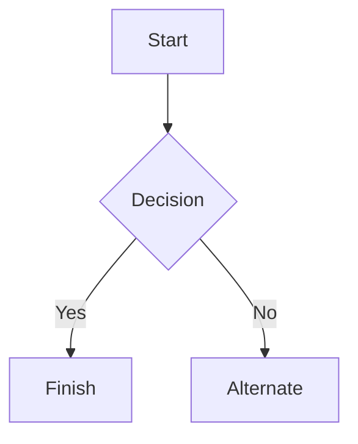

# Markdown syntax guide

## Headers

# This is a Heading h1
## This is a Heading h2
###### This is a Heading h6

## Emphasis

*This text will be italic*  
_This will also be italic_

**This text will be bold**  
__This will also be bold__

_You **can** combine them_

## Lists

### Unordered

* Item 1
* Item 2
* Item 2a
* Item 2b
    * Item 3a
    * Item 3b

### Ordered

1. Item 1
2. Item 2
3. Item 3
    1. Item 3a
    2. Item 3b

## Images


## Links

You may be using [Markdown Live Preview](https://markdownlivepreview.com/).

## Blockquotes

> Markdown is a lightweight markup language with plain-text-formatting syntax, created in 2004 by John Gruber with Aaron Swartz.
>
>> Markdown is often used to format readme files, for writing messages in online discussion forums, and to create rich text using a plain text editor.

## Tables

| Left columns  | Right columns |
| ------------- |:-------------:|
| left foo      | right foo     |
| left bar      | right bar     |
| left baz      | right baz     |

## Blocks of code

```
let message = 'Hello world';
alert(message);
```

## Mermaid diagrams


## Inline code

This web site is using `ma
 
**Fecha de Auditoría:** YYYY-MM-DD  
**Auditor Responsable:** [Nombre del Aprendiz N0 1] - [Nombre del Aprendiz N0 2]  
**Ficha:** [Número de Ficha]  
**Estado:** [En Revisión / Resuelto]  


---


## 1. Resumen Ejecutivo
Proporcione una breve descripción de máximo un (1) párrafo dirigida a la alta gerencia explicando los hallazgos generales sobre el estado de la base de datos de COMPANY SAS.


*Nota:*
*Hallazgos de Auditoría son las desviaciones, no conformidades o debilidades detectadas al contrastar la evidencia con los criterios de evaluación.*


---


## 2. Análisis de Causa Raíz por Incidente


### 2.1. Incidente Alpha (Integridad y Normalización)
* **Diagnóstico Técnico:** Explique la falla a nivel de modelo conceptual/lógico o físico.
* **Nivel de Normalización Violado:** (1FN / 2FN / 3FN) y por qué.
* **Riesgo para el Negocio:** Impacto que podría tener a nivel económico u operativo.


### 2.2. Incidente Beta (Rendimiento y DQL)
* **Consulta Problemática Identificada:** *(Inserte código fallido)*
* **Explicación del Fallo de Consultas:** Justifique la generación del producto cartesiano.
* **Cálculo de Carga:** Si la tabla A tiene N filas y la tabla B tiene M filas, explique por qué se procesan N x M registros.


### 2.3. Incidente Gamma (Integridad Referencial)
* **Diagnóstico de llaves:** Explicación de la falta de `FOREIGN KEY` correcto.
* **Diagnóstico de atomicidad:** Explicación de la falta atomicidad.
* **Consecuencia en Cascada:** Ocurrencia de registros huérfanos.


---


## 3. Plan de Refactorización y Solución Técnica


### 3.1. Ajuste Estructural (DDL Corregido)
*Escriba el script SQL para corregir las tablas afectadas, incluyendo PK, FK y restricciones (`CHECK`, `NOT NULL`).*


```sql
-- Inserte aquí el código DDL corregido